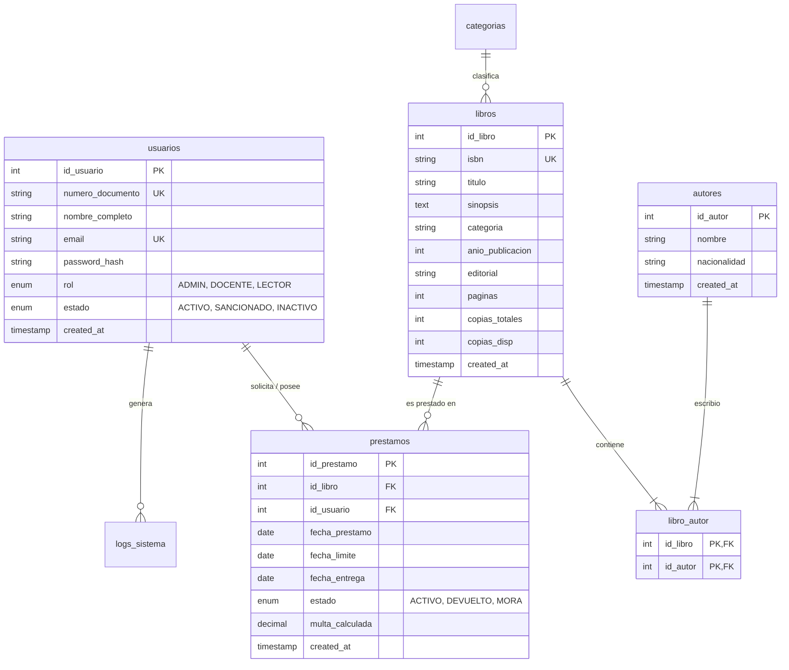

# SGBI - Documentación de la API RESTful y Arquitectura de Base de Datos (Sprint 2)

## 1. Resumen Ejecutivo y Decisiones Tecnológicas

El backend del **Sistema de Gestión de Biblioteca Integral (SGBI)** ha sido implementado bajo una arquitectura robusta, modular y de alto rendimiento, diseñada para operar tanto en entornos locales de desarrollo como en infraestructuras de producción empresarial.

### Decisiones de Arquitectura y Stack Tecnológico
- **Lenguaje y Entorno:** PHP 8.2+ sin frameworks monolíticos externos para garantizar portabilidad inmediata, mínima huella de memoria, cero dependencias frágiles de terceros y compatibilidad nativa con servidores Apache, Nginx y el servidor web integrado de PHP.
- **Patrón Arquitectural:** Router RESTful frontal (`backend-php/router.php`) con controladores orientados al dominio (`AuthController`, `CatalogoController`, `CirculacionController`, `AdminController`, `DocsController`), capa de abstracción de datos PDO (`Database.php`) y servicios de seguridad transversal (`Auth.php`, `Audit.php`).
- **Persistencia Relacional Dual Resiliente:**
  - **Producción (Primario):** MySQL 8.0+ / MariaDB con motor transaccional **InnoDB** y codificación `utf8mb4_unicode_ci` (totalmente compatible con caracteres internacionales, tildes y símbolos).
  - **Desarrollo / Respaldo (Fallback Automático):** SQLite 3 en modo WAL (`data/sgbi.db`), permitiendo ejecución inmediata sin requerir la configuración de un servicio externo si MySQL no está levantado.
- **Seguridad y Cifrado:**
  - Hash de contraseñas mediante algoritmo **BCRYPT** (`PASSWORD_BCRYPT` con factor de costo 10). Las contraseñas nunca se procesan ni persisten en texto plano.
  - Autenticación híbrida: Tokens Bearer (`Authorization: Bearer <token>`) para clientes API / REST y sesiones seguras basadas en cookies HTTP con banderas `HttpOnly`, `SameSite=Lax` y prevención de session fixation.
  - Autorización basada en roles (**RBAC**): `ADMIN` (Bibliotecario/Administrador), `DOCENTE` y `LECTOR` (Usuario final/Estudiante).
  - Sanitización estricta contra SQL Injection mediante sentencias preparadas con parámetros tipados en PDO y protección contra XSS en respuestas JSON (`X-Content-Type-Options: nosniff`, `X-Frame-Options: SAMEORIGIN`).

---

## 2. Guía de Ejecución y Pruebas del Backend

### 2.1 Requisitos Previos
- PHP 8.1 o superior con extensiones `pdo`, `pdo_mysql`, `pdo_sqlite` habilitadas.
- MySQL/MariaDB (opcional, en caso de usar el motor primario; de lo contrario SQLite se inicializa automáticamente).

### 2.2 Migraciones de Base de Datos
Ejecuta el script de migración para inicializar tablas, claves foráneas, índices, restricciones CHECK y datos de prueba:
```powershell
php backend-php/migrate.php
```

### 2.3 Puesta en Marcha del Servidor Local
Para levantar el servidor web local en el puerto `8000`:
```powershell
php -S 127.0.0.1:8000 index.php
```
*El router redirige automáticamente las peticiones de `/api/*` al controlador frontal de la API.*

### 2.4 Ejecución de la Suite de Pruebas Automatizadas
Se dispone de dos suites de pruebas para validar el cumplimiento del 100% de los requerimientos de Sprint 2:

1. **Pruebas Unitarias y de Integración (45 verificaciones):**
   ```powershell
   php backend-php/test_sprint2.php
   ```
2. **Pruebas de Integración HTTP en Vivo (12 escenarios end-to-end):**
   ```powershell
   php backend-php/test_http_endpoints.php 8000
   ```

### 2.5 Documentación Interactiva OpenAPI / Swagger
- **Swagger UI Interactivo:** [http://127.0.0.1:8000/api/docs](http://127.0.0.1:8000/api/docs)
- **Especificación OpenAPI 3.0.3 en JSON:** [http://127.0.0.1:8000/api/openapi.json](http://127.0.0.1:8000/api/openapi.json)

---

## 3. Modelo Relacional y Justificación del Esquema

El esquema relacional fue diseñado normalizado en **Tercera Forma Normal (3NF)** para garantizar integridad referencial y atomicidad.



### Justificación de Modelado y Restricciones
1. **Relación Muchos a Muchos (N:M) entre Libros y Autores (`libro_autor`):**
   - Clave primaria compuesta `(id_libro, id_autor)`.
   - `ON DELETE CASCADE` en la clave foránea del libro: si se purga un libro, sus enlaces autorales se limpian automáticamente.
   - `ON DELETE RESTRICT` en la clave foránea del autor: impide la eliminación accidental de un autor que mantenga libros en catálogo.
2. **Restricción de Integridad CHECK de Inventario (`chk_stock_valido`):**
   - Expresión: `CHECK (copias_disp >= 0 AND copias_disp <= copias_totales AND copias_totales >= 1)`.
   - Garantiza a nivel de motor de base de datos que el stock disponible nunca sea negativo ni sobrepase el inventario total.
3. **Restricción de Integridad en Préstamos:**
   - Ambas claves foráneas (`id_libro`, `id_usuario`) poseen `ON DELETE RESTRICT`. Esto garantiza que no se puedan eliminar usuarios ni libros que posean un historial de préstamo activo o en mora.
4. **Índices de Alto Rendimiento:**
   - Índices B-Tree en `email`, `numero_documento` e `isbn` con unicidad.
   - Índice compuesto en `prestamos (id_usuario, estado)` para acelerar consultas frecuentes del portal del lector.
   - Índices en `categoria`, `titulo`, `editorial` e índice FULLTEXT para búsquedas bibliográficas de texto completo.

---

## 4. Estándar de Respuestas y Códigos HTTP

Todas las respuestas de la API siguen la estructura JSON unificada:

### Respuesta Exitosa:
```json
{
  "success": true,
  "data": { ... } | [ ... ],
  "message": "Mensaje descriptivo opcional",
  "meta": {
    "page": 1,
    "limit": 20,
    "total": 100
  }
}
```

### Respuesta de Error:
```json
{
  "success": false,
  "error": "MENSAJE_O_CODIGO_ERROR",
  "detalles": "Explicación detallada del fallo"
}
```

### Códigos de Estado HTTP Utilizados:
- `200 OK`: Operación de lectura o actualización exitosa.
- `201 Created`: Recurso creado exitosamente (registro, nuevo libro, nuevo préstamo).
- `400 Bad Request`: Payload JSON inválido o parámetros requeridos faltantes.
- `401 Unauthorized`: Petición a endpoint protegido sin token o con credenciales inválidas.
- `403 Forbidden`: Usuario autenticado pero sin rol ni privilegios suficientes (ej. LECTOR intentando crear libros).
- `404 Not Found`: Recurso no encontrado en el sistema.
- `409 Conflict`: Conflicto de unicidad (documento, correo o ISBN ya registrado) o stock agotado.
- `500 Internal Server Error`: Excepción no controlada en el servidor.

---

## 5. Catálogo Completo de Endpoints RESTful

### 5.1 Módulo de Autenticación (`/api/auth`)

| Método | Ruta | Auth | Rol Mínimo | Descripción |
| :--- | :--- | :---: | :---: | :--- |
| `POST` | `/api/auth/register` | No | Público | Registra un nuevo lector en el sistema. |
| `POST` | `/api/auth/login` | No | Público | Inicia sesión y retorna token Bearer y datos de perfil. |
| `GET` | `/api/auth/me` | Sí | `LECTOR` | Retorna los datos del usuario en sesión activa. |
| `POST` | `/api/auth/logout` | No | Público | Cierra la sesión activa. |

#### `POST /api/auth/register`
- **Body Requerido:**
  ```json
  {
    "numero_documento": "100200300",
    "nombre_completo": "Ana María Gómez",
    "email": "ana.gomez@biblioteca.local",
    "password": "PasswordSeguro123"
  }
  ```
- **Respuesta `201 Created`:**
  ```json
  {
    "success": true,
    "data": {
      "id_usuario": 11,
      "numero_documento": "100200300",
      "nombre_completo": "Ana María Gómez",
      "email": "ana.gomez@biblioteca.local",
      "rol": "LECTOR"
    },
    "token": "tok_...",
    "message": "Usuario registrado exitosamente"
  }
  ```

#### `POST /api/auth/login`
- **Body Requerido:**
  ```json
  {
    "email": "admin@biblioteca.local",
    "password": "admin"
  }
  ```
- **Respuesta `200 OK`:**
  ```json
  {
    "success": true,
    "data": {
      "id_usuario": 1,
      "nombre_completo": "Administrador Principal",
      "email": "admin@biblioteca.local",
      "rol": "ADMIN"
    },
    "token": "tok_..."
  }
  ```

---

### 5.2 Módulo de Libros y Catálogo (`/api/libros`)

| Método | Ruta | Auth | Rol Mínimo | Descripción |
| :--- | :--- | :---: | :---: | :--- |
| `GET` | `/api/libros` | No | Público | Lista libros con filtros de búsqueda, categoría y paginación. |
| `GET` | `/api/libros/{id}` | No | Público | Obtiene el detalle de un libro incluyendo sus autores. |
| `POST` | `/api/libros` | Sí | `ADMIN` | Crea un nuevo libro en el catálogo. |
| `PUT` | `/api/libros/{id}` | Sí | `ADMIN` | Actualiza los datos de un libro existente. |
| `DELETE` | `/api/libros/{id}` | Sí | `ADMIN` | Elimina un libro del catálogo si no tiene préstamos activos. |
| `PATCH` | `/api/libros/{id}/copias`| Sí | `ADMIN` | Ajusta el inventario total y disponible de un libro. |

#### `GET /api/libros`
- **Query Parameters:**
  - `search` *(opcional)*: Término de búsqueda en título, sinopsis o temas clave.
  - `categoria` *(opcional)*: Filtro por nombre de categoría.
  - `disponible` *(opcional, `1` ó `0`)*: Solo libros con ejemplares disponibles.
  - `page` *(opcional, default `1`)*: Página actual.
  - `limit` *(opcional, default `20`)*: Cantidad de resultados por página.

#### `POST /api/libros`
- **Headers:** `Authorization: Bearer <token_admin>`
- **Body Requerido:**
  ```json
  {
    "isbn": "978-0140449136",
    "titulo": "La Odisea",
    "sinopsis": "Poema épico atribuido a Homero.",
    "categoria": "Literatura Clásica",
    "anio_publicacion": -800,
    "editorial": "Penguin Classics",
    "idioma": "Español",
    "paginas": 448,
    "copias_totales": 4,
    "id_autores": [1, 2]
  }
  ```
- **Respuesta `201 Created`:**
  ```json
  {
    "success": true,
    "data": {
      "id_libro": 14,
      "isbn": "978-0140449136",
      "titulo": "La Odisea",
      "copias_totales": 4,
      "copias_disp": 4
    },
    "message": "Libro registrado exitosamente"
  }
  ```

---

### 5.3 Módulo de Autores (`/api/autores`)

| Método | Ruta | Auth | Rol Mínimo | Descripción |
| :--- | :--- | :---: | :---: | :--- |
| `GET` | `/api/autores` | No | Público | Lista todos los autores registrados. |
| `GET` | `/api/autores/{id}`| No | Público | Obtiene información de un autor y sus libros asociados. |
| `POST` | `/api/autores` | Sí | `ADMIN` | Registra un nuevo autor. |
| `PUT` | `/api/autores/{id}`| Sí | `ADMIN` | Actualiza datos de un autor. |
| `DELETE` | `/api/autores/{id}`| Sí | `ADMIN` | Elimina un autor (restringido si posee libros vinculados). |

---

### 5.4 Módulo de Circulación y Préstamos (`/api/prestamos`)

| Método | Ruta | Auth | Rol Mínimo | Descripción |
| :--- | :--- | :---: | :---: | :--- |
| `GET` | `/api/prestamos` | Sí | `LECTOR` | Lista préstamos. LECTORES ven los propios; ADMIN ve todos con filtros. |
| `GET` | `/api/prestamos/{id}` | Sí | `LECTOR` | Detalle del préstamo (validando pertenencia o rol ADMIN). |
| `POST` | `/api/prestamos` | Sí | `LECTOR` | Solicita préstamo. Valida stock y decrementa `copias_disp` atómicamente. |
| `PUT` | `/api/prestamos/{id}` | Sí | `ADMIN` | Actualiza fechas límite o estado administrativo. |
| `PATCH`| `/api/prestamos/{id}/devolver` | Sí | `LECTOR` | Registra devolución, calcula recargo por mora e incrementa stock. |
| `DELETE`| `/api/prestamos/{id}` | Sí | `ADMIN` | Cancela préstamo y restaura stock si estaba activo. |

#### `POST /api/prestamos`
- **Headers:** `Authorization: Bearer <token>`
- **Body:**
  ```json
  {
    "id_libro": 1,
    "dias_prestamo": 14
  }
  ```
- **Respuesta `201 Created`:**
  ```json
  {
    "success": true,
    "data": {
      "id_prestamo": 8,
      "id_libro": 1,
      "titulo": "Cien Años de Soledad",
      "fecha_prestamo": "2026-11-20",
      "fecha_limite": "2026-12-04",
      "estado": "ACTIVO"
    },
    "message": "Préstamo registrado exitosamente"
  }
  ```

---

### 5.5 Módulo de Usuarios y Administración (`/api/usuarios`)

| Método | Ruta | Auth | Rol Mínimo | Descripción |
| :--- | :--- | :---: | :---: | :--- |
| `GET` | `/api/usuarios` | Sí | `ADMIN` | Lista todos los usuarios con filtros por rol y estado. |
| `GET` | `/api/usuarios/{id}` | Sí | `ADMIN` | Obtiene el perfil completo y préstamos de un usuario. |
| `POST` | `/api/usuarios` | Sí | `ADMIN` | Crea un usuario con rol asignado (`ADMIN`, `DOCENTE`, `LECTOR`). |
| `PUT` | `/api/usuarios/{id}` | Sí | `ADMIN` | Modifica rol, estado, documento o datos personales. |
| `DELETE`| `/api/usuarios/{id}` | Sí | `ADMIN` | Desactiva o elimina un usuario si no tiene historial activo. |

---

### 5.6 Módulo de Infraestructura y Salud del Sistema

| Método | Ruta | Auth | Descripción |
| :--- | :--- | :---: | :--- |
| `GET` | `/api/health` | No | Estado operativo del backend, base de datos y latencia. |
| `GET` | `/api/estadisticas` | No | Conteos consolidados de libros, autores, préstamos y usuarios. |
| `GET` | `/api/categorias` | No | Catálogo de categorías temáticas de la biblioteca. |
| `GET` | `/api/salas` | No | Áreas físicas y salas de lectura disponibles. |
| `GET` | `/api/openapi.json` | No | Especificación estándar OpenAPI 3.0.3 en formato JSON. |
| `GET` | `/api/docs` | No | Interfaz visual interactiva Swagger UI embebida. |

---

## 6. Resultados de Validación y Verificación Técnica

La suite de pruebas automatizadas ejecutada directamente contra el servidor arrojó resultados 100% satisfactorios:

```text
=== PRUEBA DE ENDPOINTS HTTP RESTful EN VIVO (127.0.0.1:8000) ===

[1] GET /api/health -> Status: 200 (OK)
[2] GET /api/openapi.json -> Status: 200 (OpenAPI v3.0.3)
[3] GET /api/libros -> Status: 200 (Total libros: 10)
[4] POST /api/libros (Sin auth) -> Status: 401 (Esperado: 401 Unauthorized)
[5] POST /api/auth/register -> Status: 201 (Nuevo ID: 11)
[6] POST /api/auth/login (Admin) -> Status: 200 (Rol: ADMIN, Token: 1)
[7] POST /api/auth/login (Clave errónea) -> Status: 401 (Esperado: 401)
[8] POST /api/libros (Con Bearer Admin) -> Status: 201 (ID Libro: 14)
[9] POST /api/libros (Con Bearer Lector) -> Status: 403 (Esperado: 403 Forbidden)
[10] PUT /api/libros/14 -> Status: 200 (OK)
[11] DELETE /api/libros/14 -> Status: 200 (OK)
[12] GET /api/libros/14 (Eliminado) -> Status: 404 (Esperado: 404 Not Found)

>>> TODAS LAS 12 PRUEBAS HTTP EN VIVO SE COMPLETARON CON ÉXITO <<<
```
